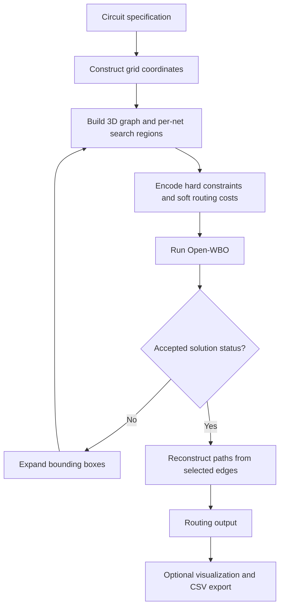
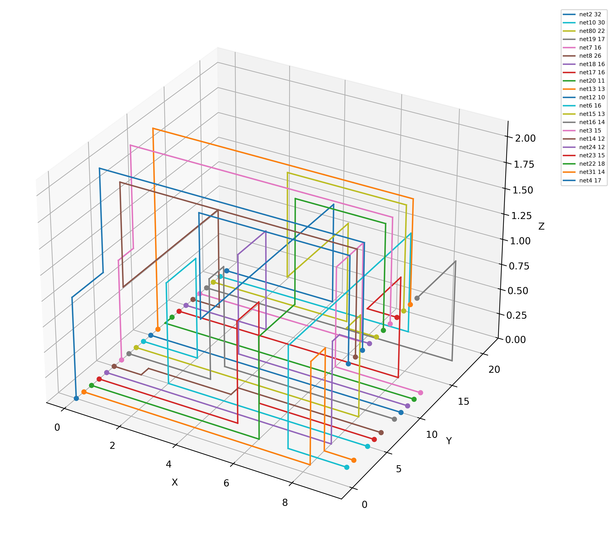

# MaxSAT-Based Multi-Layer Routing

A C++14 VLSI routing project that connects two-pin nets across multiple metal layers using weighted partial MaxSAT. The router constructs a 3D grid, encodes routing constraints and cost preferences in WCNF, and uses Open-WBO to select routing edges before reconstructing the output paths.

## My Contribution

I implemented the routing logic and data structures in [`router.cpp`](router.cpp) and [`router.hpp`](router.hpp), building on the provided framework and integrating Open-WBO as the external solver. The implementation includes:

- **3D grid construction:** pin-aligned coordinate lines with additional pitch-based tracks, horizontal and vertical routing edges, and vias between adjacent layers.
- **Adaptive search regions:** per-net bounding boxes that expand in X and Y when a solve does not return an accepted solution status, while keeping all layers available from the first iteration.
- **Routing constraint encoding:** degree-one pins, degree-zero-or-two internal nodes, edge-to-node occupancy implications, and row and column crossing clauses between the pins.
- **Node exclusivity:** at-most-one constraints prevent different nets from occupying the same grid node, using sequential-counter encoding when more than two nets can use a node.
- **Weighted routing preferences:** wirelength and via costs, layer-direction preferences, and a conditional turn penalty expressed as soft clauses.
- **Solver integration and path reconstruction:** WCNF generation, solver-status and assignment parsing, and source-to-target traversal of selected edges with used-edge tracking.

The project applies graph modeling, Boolean constraint encoding, and combinatorial optimization to an electronic design automation (EDA) problem. Routing choices are made through the solver formulation; path reconstruction does not run a separate rerouting or path-optimization algorithm.

## Routing Pipeline



Each net initially uses the X-Y bounding box of its pins. On a retry, every net's box expands by one grid index per side, clipped to the grid boundary. The model is rebuilt for each iteration, and all nets are solved together.

Hard clauses describe routing constraints, while soft clauses penalize selected edges and certain turns. The hard-clause weight is set to the sum of all soft-clause weights plus one. For node exclusivity, the sequential-counter encoding uses a linear number of auxiliary variables and clauses in the number of candidate nets at that node.

## Build and Run

### Requirements

- A C++14 compiler, such as `g++`
- GNU Make
- A compatible [Open-WBO](https://github.com/sat-group/open-wbo) executable
- Python 3 with `numpy`, `matplotlib`, and `pandas` for visualization and CSV export
- Bash if using `run.sh`

The commands below use a Linux or WSL shell. Run them from this project's root directory: the router invokes `./open-wbo` and writes its intermediate files in the current working directory. Obtain or build Open-WBO using the upstream project's instructions and place the executable at `./open-wbo`; the solver binary is excluded from this repository.

The reference environment was CentOS 8 with GCC 8.5.0. The router expects Open-WBO to emit model assignments as signed integer literals.

### Build

```bash
chmod +x open-wbo
make
```

The Makefile builds `Lab3` with C++14 and `-O2`. If reusing a checkout that contains object files or an executable built on another machine, run `make clean` before rebuilding.

### Route a design

```bash
./Lab3 case/case1.txt case/case1_out.txt
```

The command-line interface takes an input specification and an output path:

```text
./Lab3 <inputFile> <outputFile>
```

Each solver invocation writes `clause.sat`, the WCNF input, and `sat_result.txt`, the solver log and assignment. These files are overwritten on each iteration and are excluded from version control.

### Visualize and export the output

```bash
python3 -m pip install numpy matplotlib pandas
python3 plotter.py case/case1_out.txt
python3 convert_submission_to_csv.py case/case1_out.txt case/case1_out.csv
```

The plotter saves `case/case1_out.jpg`. The CSV utility produces an `id` column and a `routing_result` column containing the serialized route text.

To run all six supplied inputs through the existing batch script:

```bash
bash run.sh
```

This script rebuilds the router, runs `case1` through `case5` and `bonus`, and overwrites the corresponding routing text, CSV files, and images in `case/`. It does not verify route correctness; no automated correctness verifier is included.

## Evaluation

The physical routing objective is to minimize `wirelength + via_count * via_cost` while connecting the nets without sharing grid nodes between nets.

| Metric | Meaning |
| --- | --- |
| Wirelength | Sum of physical lengths of horizontal and vertical path segments |
| Via count | Number of transitions between adjacent layers |
| Physical routing cost | Wirelength plus via count multiplied by the input's via cost |
| Solver objective | Total weight of unsatisfied soft clauses, including routing preferences |
| Runtime | Elapsed time across graph construction, encoding, solving, and path reconstruction |

The solver objective includes additional preferences beyond physical routing cost. Non-preferred edges receive an extra `min_pitch_size` penalty: even layers prefer horizontal routing, and odd layers prefer vertical routing. This penalty is disabled when every net has aligned pins on its own source/target layer. When `via_cost == 10000`, an additional `via_cost` penalty applies to each selected horizontal/vertical edge pair at a node.

The included inputs cover `case1` through `case5` and `bonus`, with 4 to 25 nets and one to three available layers. No benchmark performance or optimality claims are made here without a recorded run tied to this source version and execution environment.

### Routing Example



An existing visualization for `case3`, which contains 21 nets and allows three layers. Colors distinguish nets; X and Y show grid indices, and Z shows the layer index. This is an illustrative output, not a verified benchmark result for the current source version.

## Implementation Notes

- **Coordinate representation:** input pins use physical coordinates and zero-indexed layers. The output lists the X and Y coordinate arrays, followed by each net's path as `(x_index, y_index, layer)` entries. The plotter uses these indices directly, so nonuniform physical spacing is not shown to scale.
- **Optimality scope:** the router accepts either `SATISFIABLE` or `OPTIMUM FOUND` and stops at the first accepted iteration. A solver optimum applies to that iteration's restricted graph and weighted objective; it does not establish globally minimum physical routing cost.
- **Runtime controls:** Open-WBO receives `-cpu-lim=480` for each invocation. There is no overall retry limit or terminal failure condition after the search regions reach the full grid, so this is not an end-to-end runtime bound.
- **Concurrent execution:** runs share `clause.sat` and `sat_result.txt`. Use separate working directories for concurrent runs.
- **Model scope:** the implementation supports two-pin routing. Obstacles, multi-pin nets, and a complete set of manufacturing design rules are not modeled.

## Source Guide and Attribution

| File or component | Role and origin |
| --- | --- |
| [`router.cpp`](router.cpp) | My implementation of graph construction, constraint encoding, solver handling, and path reconstruction |
| [`router.hpp`](router.hpp) | My router interface and node, edge, and net data structures |
| [`main.cpp`](main.cpp) | Provided driver for input parsing, iterative solving, and output |
| [Open-WBO](https://github.com/sat-group/open-wbo) | External MaxSAT solver; obtained separately |
| [`Makefile`](Makefile) | Build configuration for the `Lab3` executable |
| [`run.sh`](run.sh) | Batch routing, visualization, and CSV export script |
| [`plotter.py`](plotter.py) | Supporting 3D routing visualization utility |
| [`convert_submission_to_csv.py`](convert_submission_to_csv.py) | Supporting CSV submission utility |
| `case/` | Six example inputs and the retained README illustration |

My implementation contribution is limited to `router.cpp` and `router.hpp`. The driver, supporting utilities, and external solver are credited separately from that work.
